# Quantum Genetic Algorithm Optimization of VMD Parameters, Five Different Fitness Functions Switchable, Minimize Envelope Entropy, Sample Entropy, Information Entropy, Arrangement Entropy, Arrangement Entropy/Mutual Information Entropy

If there are some images that cannot be displayed, please move to gzh: Taojia Code, search the article title to find this article!  
Regarding quantum genetic algorithms, they have been widely applied in numerous literature. Below is a brief explanation of their principles.  
(1) Quantum bit encoding  
Sub-genetic algorithms complete the storage and expression of genes by introducing quantum bits. Quantum bits are concepts in quantum information, different from classical bits because they can exist in two states at the same time. A two-state gene using one quantum bit for encoding is as follows:  
α and β are constants with values satisfying the equation:  
φ no longer represents a definite message but can be either "0" state or "1" state, becoming a carrier of information that can express both possibilities. Using n quantum bits to encode m parameters of an individual's gene in the population:  
In the formula, uj t represents the chromosome of the jth individual in the tth generation.  
(2) Quantum rotation gate  
Quantum gates are important steps in the algorithm for evolutionary processes. The selection of quantum gates directly determines whether the population can evolve successfully and in which direction [11]. Here, we choose quantum rotation gates as the evolutionary strategy for the population. The adjustment operation of the quantum rotation gate is as follows:  
First, adjust the strategy to determine the rotation angle θi, and when updating the current individual u, it needs to compare the current population's best individual best to determine the direction s (αi, βi). Calculate the fitness of the current individual's measurement value and the current population's best individual's fitness (fbest). If (fu)>(f best), then change the corresponding quantum bit in u to guide the probability amplitude constant αi, βi towards the direction that is beneficial for individual u; if (fu)<(f best), also change the corresponding quantum bit in u to guide the probability amplitude constant αi, βi towards the direction that is beneficial for the best individual.  
In the CEC2005 test function, the performance is as follows:
The steps of quantum genetic algorithm are as follows:
Quantum Genetic Algorithm Optimization of VMD Parameters
This issue employs the quantum genetic algorithm to optimize VMD parameters. The MATLAB's official VMD function is utilized.
After replacing the official VMD function, the optimization speed has indeed significantly improved! If you have a large dataset, try this official VMD function. Of course, you need to download MATLAB 2020a and above for this!
Taking the Xiuyun University dataset as an example, select 1000 data points from X105_BA_time.mat in 105.mat. For those without data, refer to this article. Xiuyun University Bearing Diagnosis Data Processing with MATLAB Free Code
Select five fitness functions for optimization to determine the optimal k and α parameters of VMD. The five fitness functions are: Minimized Entropy of Envelope, Minimized Entropy of Sample, Minimized Entropy of Information, Minimized Arrangement Entropy, Arrangement Entropy/Mutual Information Entropy. Code can be switched one-click. As for which one to choose as your fitness function, you can refer to this article. Why does VMD need parameter optimization? Which is the best among Minimized Entropy of Envelope/Sample/Arrangement Entropy/Information Entropy, what should be the fitness function?
1. Minimum Entropy as the fitness function
2. Minimum sample entropy as the fitness function
3. Minimum Information Entropy as the Fitness Function
4. Minimum Arrangement Entropy as the Fitness Function
5. Composite indicators as fitness functions
The introduction of the composite indicator is as follows:
This indicator is derived from the literature: Lu Tie Ding, He Jin Liang, He Xiao Xing et al. GNSS coordinate time series denoising method based on parameter optimization variational mode decomposition [J/OL]. Wuhan University Journal of Information Science Edition, 1-15 [2024-02-29]. https://doi.org/10.13203/j.whugis20220363.
Results:

## Images

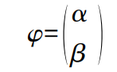
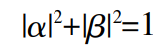
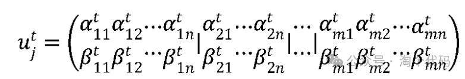
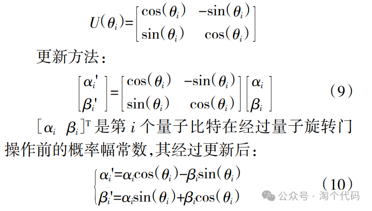
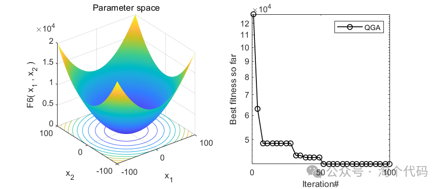
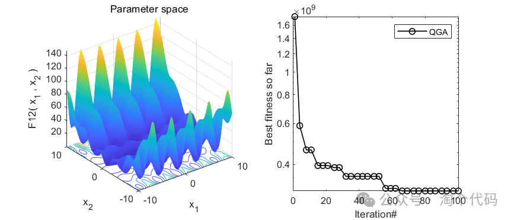
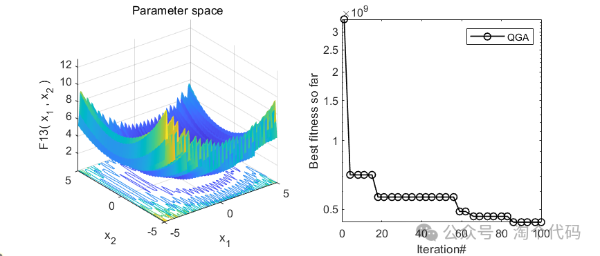
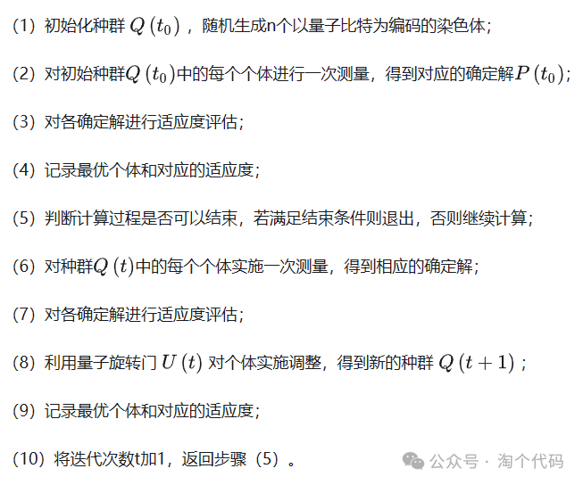
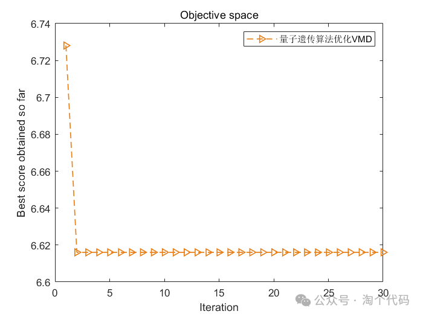
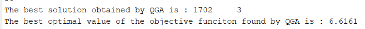
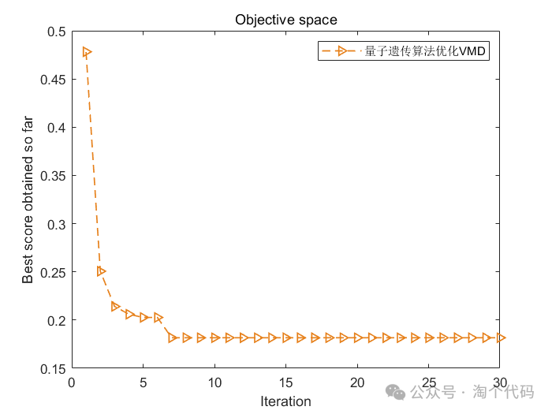
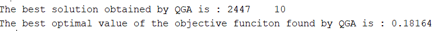
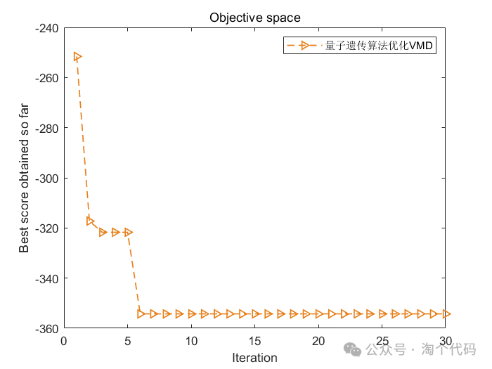
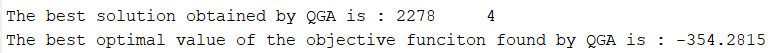
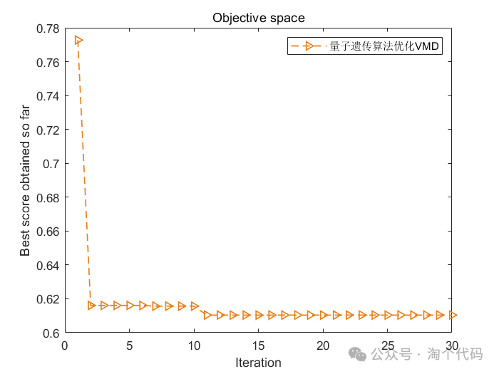
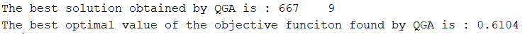

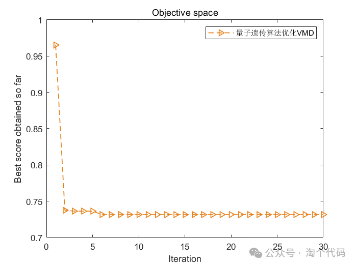
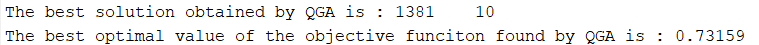

<!-- PAYMENT_BLOCK -->

## Get this dataset

- Payment link (Stripe): [Buy now](https://buy.stripe.com/3cs8yP7sY87d0vu9AB)
- Payment QR code: 

<!-- /PAYMENT_BLOCK -->
